# RL-дообучение последовательной рекомендательной модели (Yambda-50M)

Отчёт к заданию отбора на стажировку в команду AI Research (Т-Банк): обучить GPT-2-подобную модель next-item prediction, построить модель вознаграждения (reward model, RM), дообучить рекомендатель с помощью RL и исследовать, что при этом происходит с поведением модели и релевантностью.

- **Репозиторий:** `https://github.com/AlexDm207/yambda.git`
- **Автор:** `Дмитрович Александра Дмитриевна`
- **Данные:** Yambda-50M (Яндекс Музыка), `flat/50m/multi_event.parquet`
- **Железо:** один ноутбук, RTX 3050 Ti (4,3 ГБ VRAM), все запуски локально
- **Теги репозитория:** `v0.1-experiments`, `v0.2-diagnostics`, `v0.3-final-experiments` (состояние после заморозки экспериментов)

---

## 1. Резюме

**Что сделано.** Временной сплит без утечек, базовая модель (15,99 млн параметров), две reward model, три семейства методов дообучения (on-policy RL, дистилляция замкнутого оптимума, переранжирование), набор вариантов награды, оценка при генерации на 5 шагов вперёд и модель долгосрочных исходов. Все ключевые числа получены на 3 seed (где указано) и с 95% доверительными интервалами по пользователям. Тест открыт после заморозки списка конфигураций.

**Главные результаты.**

1. **Базовая модель сильна.** Recall@10 = 0,348 на val и 0,332 на тесте против 0,236 / 0,234 у лучшего простого baseline (самые частые треки недавней истории пользователя) и 0,018 / 0,015 у популярности. На новых для пользователя треках 0,203 (val) против 0,012 у популярности.
2. **Reward model хорошая и устойчивая во времени.** ROC-AUC «дослушал трек» 0,817 (val) / 0,815 (test) против 0,715 / 0,707 у baseline «трек + пользователь», калибровка ECE 0,016–0,019.
3. **RL увеличивает награду, но платит релевантностью дороже, чем простое переранжирование.** При одинаковой средней награде по RM Recall@10 у RL ниже на 0,025–0,136 (интервалы не включают ноль, на 3 seed, val и test согласуются до 0,003). Мягче всего ведёт себя дистилляция замкнутого оптимума (разрыв −0,006…−0,018).
4. **Рост награды сопровождается нежелательным поведением**: концентрация на небольшом наборе треков (один трек до 9,9% всех слотов, покрытие каталога 0,58 → 0,09), сокращение длины треков, падение доли повторов из истории пользователя.
5. **Реальные исходы по логам** (реальная доля прослушивания на попаданиях) подтверждают, что RM различает хорошие и плохие треки, но суммарно ни один метод не улучшил результат относительно базовой модели.
6. **Долгосрочные цели** не удалось приблизить офлайн: предсказанные исходы сессии и возврата на следующий день определяются контекстом на 97–99%, а выбором трека на 0,2–1,4%.

**Неудачи (кратко, подробнее в разделе 9).** RL не превзошёл переранжирование ни при одной настройке; моё заранее записанное предположение о причине (проблема только в контекстной части награды) было опровергнуто собственным экспериментом; многошаговое RL не уменьшило дрейф; `rm_b` оказалась почти копией `rm_a`, поэтому проверка взлома награды слабая.

---

## 2. Структура отчёта

| Вопрос задания | Раздел |
|---|---|
| Как меняется поведение модели после RL? Удаётся ли максимизировать награду? | [6.1](#61-удаётся-ли-максимизировать-награду-и-как-меняется-поведение) |
| Сохраняется ли релевантность? Нет ли рекомендаций «всем одно и то же»? | [6.2](#62-сохраняется-ли-релевантность) |
| Можно ли приблизиться к долгосрочным целям? Что проверяется офлайн, а что нет? | [7.2](#72-долгосрочные-цели) |
| Что происходит при генерации нескольких шагов вперёд? | [7.1](#71-генерация-на-несколько-шагов-вперёд) |
| Каков компромисс релевантность — награда, как на него влияют награда и настройки RL? | [6.3](#63-компромисс-релевантность--награда), [6.4](#64-влияние-функции-награды-и-настроек-rl) |
| Постановка эксперимента, результаты, ограничения, дальнейшая работа | разделы 3–5, 9, 10 |

---

## 3. Данные и протокол

### 3.1. Датасет

Yambda-50M: 10 000 пользователей, 934 057 треков, 46,47 млн прослушиваний (поля `played_ratio_pct`, `is_organic`, `track_length_seconds`), лайки и дизлайки, около 301 суток (единица `timestamp` — секунда, округление до 5 с).

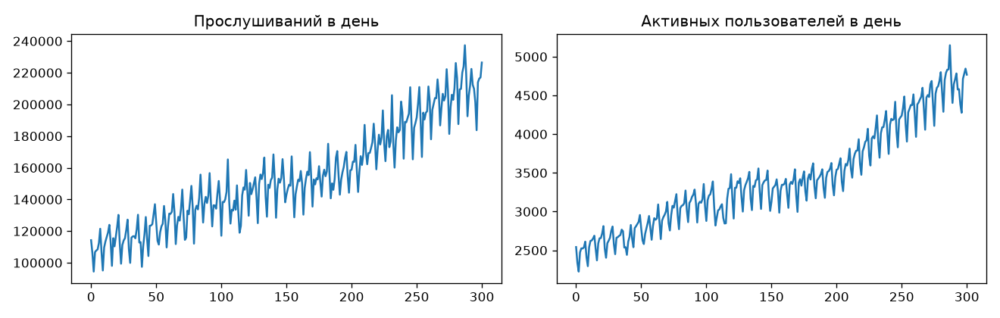

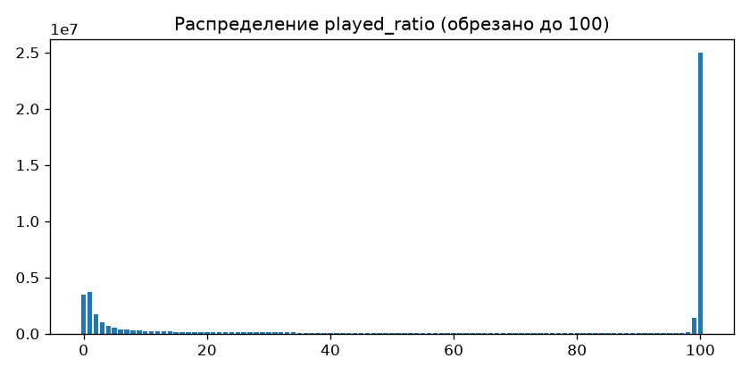

Что показал EDA и как это повлияло на решения:

| Наблюдение | Решение |
|---|---|
| Доля прослушивания бимодальна: 63% прослушиваний с ratio ≥ 50, около 25 млн ровно со значением 100, много скипов | цели RM: доля прослушивания, «дослушал» (ratio ≥ 50), лайк, дизлайк; значения > 100 обрезаются |
| Organic-события (52%) слушаются реже (ratio ≥ 50: 58,8%), чем рекомендованные прежней системой (68,2%) | основной эксперимент только по organic-прослушиваниям, чтобы не копировать прежний рекомендатель |
| 76,7% organic-прослушиваний это повторы | треки из истории не маскируются; метрики считаются отдельно для повторов и новых |
| Топ-50k треков закрывают 80,4% train-событий, но 73,4% будущих | словарь 50 000 треков (токены 0 = PAD, 1 = UNK) |
| Рост активности и недельная сезонность | val и test по полной неделе |
| Короткие треки дослушиваются чаще (73% у треков < 1 мин, 53% у > 8 мин) | вводятся варианты награды, учитывающие длину |

### 3.2. Временной сплит и защита от утечек

| Период | Дни | События (organic) | Пользователи |
|---|---|---|---|
| train | [0, 285) | 22 257 856 | 8 822 |
| зазор | [285, 286) | 113 640 | |
| val | [286, 293) | 778 377 | 6 900 |
| зазор | [293, 294) | 110 905 | |
| test | [294, 301) | 742 879 | 6 803 |

- Зазоры в сутки превышают порог сессии (30 минут), поэтому сессия не пересекает границу периодов.
- Словарь и все статистики (частоты, средние по трекам, длины) строятся только по train.
- История пользователя для val/test включает только события до момента предсказания.
- Доля событий с целью в словаре: train 80,3%, val 75,8%, test 74,7%. Метрики релевантности считаются только по целям внутри словаря (это потолок 71–74% контекстов).
- В `prepare.py` и в загрузчике стоят проверки (assert) на монотонность периодов и временную упорядоченность.

### 3.3. Протокол оценки

- Для каждого пользователя случайно выбираются до 10 целевых событий из периода (фиксированный seed), контекст — предыдущие 128 событий.
- Модель ранжирует все 50 000 треков (кроме PAD и UNK). Считаются Recall@K, NDCG@K и MAP@K (при одной цели MAP@K совпадает с MRR@K).
- Срезы: `all`, `positive` (ratio ≥ 50), `repeat` (трек уже был у пользователя), `new` (слышит впервые).
- **Основные таблицы:** 20 000 контекстов (≈6 000 пользователей) на val и test; 95% интервалы — бутстрэп по пользователям (1 000 повторов). Рисунки построены по протоколу с 6 000 контекстов (то же направление выводов, интервалы шире); тест 6 000 приведён как проверка устойчивости.
- Для сравнения методов при одинаковой награде введён протокол «разрыв до кривой переранжирования» (раздел 5.3).

---

## 4. Базовые модели и reward model

### 4.1. Базовая модель next-item prediction

GPT-2-подобная модель на чистом PyTorch: 4 слоя, 4 головы, d = 256, контекст 128, связанные эмбеддинги (weight tying), 15,99 млн параметров; bf16, AdamW, косинусное расписание, 4 эпохи (≈15 минут на эпоху на RTX 3050 Ti). Две версии: `base_all` (любое следующее прослушивание) и `base_pos` (только прослушивания с ratio ≥ 50, baseline «next-positive» из статьи 2).

Результаты (в срезе `all`; полный протокол по всем примерам периода: val 62 355, test 60 932 оценочных примера):

| Метод | val R@10 | val NDCG@10 | val MAP@10 | test R@10 | test NDCG@10 | test MAP@10 |
|---|---|---|---|---|---|---|
| популярность | 0,018 | 0,009 | 0,006 | 0,015 | 0,007 | 0,005 |
| частые треки недавней истории | 0,236 | 0,128 | 0,096 | 0,234 | 0,127 | 0,095 |
| `base_pos` | 0,309 | 0,179 | 0,139 | 0,292 | 0,168 | 0,130 |
| **`base_all`** | **0,348** | **0,207** | **0,163** | **0,332** | **0,199** | **0,157** |

Срезы для `base_all` (Recall@10): повторы 0,398 (val) / 0,378 (test), новые треки 0,203 / 0,190 (популярность на новых: 0,012 / 0,006). Выдача модели персонализирована: покрытие каталога в топ-10 0,75 (val) и 0,74 (test), доля 100 самых популярных треков в выдаче 9,3% / 9,1%, самый частый трек занимает 0,8% слотов.

Фильтрация позитивных целей (`base_pos`) не помогла: хуже `base_all` во всех срезах, в том числе на самих позитивных целях. Причины не проверялись (вероятно, вклад меньшего числа целей на шаг и недообученность: метрики росли до последней эпохи).

### 4.2. Reward model

Тот же трансформер, на входе на каждой позиции: трек-кандидат, логарифм длины трека и фидбэк предыдущего события (сдвиг на один шаг исключает утечку цели). Четыре головы: доля прослушивания (мягкая BCE), «дослушал», лайк, дизлайк. Две модели: `rm_a` (4×256, обучение политики) и `rm_b` (3×192, другой seed, проверочная).

| Метрика (в словаре) | `rm_a` val | `rm_a` test | baseline «трек + пользователь» test |
|---|---|---|---|
| ROC-AUC «дослушал» | 0,817 | 0,815 | 0,707 |
| MAE доли прослушивания | 0,279 | 0,279 | 0,340 |
| ECE «дослушал» | 0,016 | 0,019 | |
| лайк: ROC-AUC / PR-AUC | 0,879 / 0,169 | 0,869 / 0,178 | базовая частота лайка 0,005 |
| дизлайк ROC-AUC | 0,821 | 0,836 | |

RM лучше baseline во всех срезах (популярность треков, длина, повторы/новые), на новых треках AUC даже выше (0,826 val / 0,823 test). `rm_b` даёт те же показатели (test AUC 0,814). Это **ограничение**: две RM обучены на одних данных, поэтому `rm_b` не является независимым судьёй (см. раздел 9).

---

## 5. RL-дообучение

### 5.1. Метод

On-policy REINFORCE с групповым baseline (leave-one-out) в духе GRPO/RLOO:

- контекст: 127 реальных событий; политика сэмплирует следующий трек из полного словаря (температура 1);
- награда: предсказанная `rm_a` доля прослушивания сгенерированного трека (в основном эксперименте);
- G = 16 сэмплов на контекст, 32 контекста на шаг, 300 шагов, lr 3·10⁻⁵;
- преимущество = награда − среднее по группе, нормировка на std батча;
- штраф за расхождение с референсной политикой `base_all`: точная KL по всему словарю, коэффициент β;
- якорь SFT (cross-entropy на реальном следующем треке), λ = 0,1.

Оптимум KL-регуляризованной задачи имеет вид π* ∝ π_ref · exp(r/β): распределение Больцмана, где β играет роль температуры. Из этого следует сильный baseline без RL: **переранжирование топ-100 кандидатов** базовой модели по score = log π + α · r (α ≈ 1/β). Он реализован и используется как референс для всех сравнений.

Дополнительный метод: **дистилляция замкнутого оптимума** — политика обучается кросс-энтропией приближать q ∝ π_ref · exp(α·r) на 100 кандидатах (хвост словаря сохраняет массу референса).

### 5.2. Что мониторится в обучении

Награда по `rm_a` и по `rm_b`, KL к референсу, энтропия, log10 ранга популярности выбираемых треков, длина треков, доля треков из истории, доля уникальных выбранных треков.

### 5.3. Протокол сравнения методов

Кривая «Recall@10 — средняя награда в топ-10» строится для переранжирования базовой модели при α ∈ [0, 300]. **Разрыв** метода — это его Recall@10 минус Recall@10, который переранжирование даёт при той же достигнутой награде (линейная интерполяция по кривой); отрицательный разрыв означает «дороже платит релевантностью». Разрыв считается по обеим RM (`rm_a`, на которой обучали, и `rm_b`) с 95% бутстрэп-интервалами по пользователям. Если награда метода выходит за диапазон кривой, разрыв не определён (`nan`).

---

## 6. Основные результаты

### 6.1. Удаётся ли максимизировать награду и как меняется поведение

Сводная таблица (R@10 и NDCG@10 по контекстам, где цель в словаре; 20 000 контекстов; доверительные интервалы 95% в `reports/tables.md`):

| Метод | seeds | val R@10 | val награда `rm_a` | val разрыв | test R@10 | test разрыв |
|---|---|---|---|---|---|---|
| `base_all` (переранжирование α=0) | 1 | 0,345 | 0,645 | | 0,327 | |
| переранжирование α=10 | 1 | 0,333 | 0,686 | | 0,312 | |
| переранжирование α=30 | 1 | 0,279 | 0,714 | | 0,261 | |
| переранжирование α=100 | 1 | 0,183 | 0,727 | | 0,171 | |
| RL β=0,4 | 3 | 0,316 | 0,674 | −0,025 [−0,029; −0,022] | 0,292 | −0,028 [−0,032; −0,024] |
| RL β=0,2 | 3 | 0,258 | 0,696 | −0,060 [−0,065; −0,055] | 0,238 | −0,060 [−0,065; −0,055] |
| RL β=0,1 | 3 | 0,159 | 0,720 | −0,082 [−0,092; −0,072] | 0,144 | −0,082 [−0,092; −0,073] |
| RL β=0,05 | 3 | 0,109 | 0,720 | −0,136 [−0,146; −0,127] | 0,095 | −0,136 [−0,145; −0,127] |
| дистилляция α=30 | 3 | 0,319 | 0,677 | −0,020 [−0,023; −0,017] | 0,300 | −0,018 [−0,022; −0,015] |
| дистилляция α=10 | 1 | 0,340 | 0,662 | −0,006 [−0,009; −0,003] | 0,318 | −0,007 [−0,010; −0,004] |
| `base_pos` | 1 | 0,308 | 0,653 | −0,039 [−0,044; −0,034] | 0,286 | −0,041 [−0,046; −0,035] |

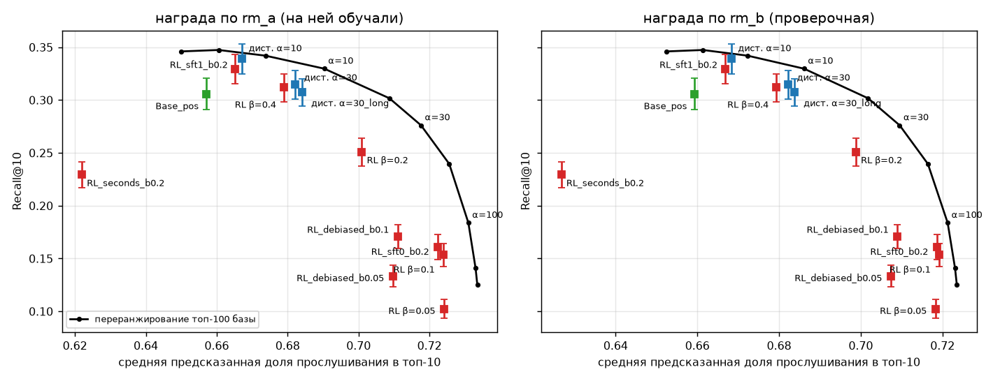

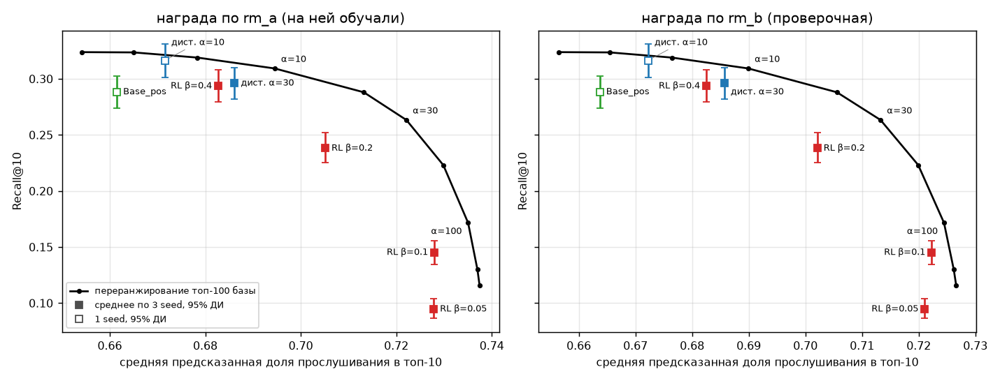

**Награда максимизируется**: с 0,645 до 0,720 (+12%) при β ≤ 0,1, и независимая проверочная `rm_b` растёт почти так же (на 0,066 против 0,074 у `rm_a` в первом запуске), то есть это не только взлом `rm_a`. По разрыву `rm_a` и `rm_b` дают одинаковые выводы (на тесте: −0,028/−0,026, −0,060/−0,054, −0,136/−0,112 при β=0,4/0,2/0,05); при β=0,1 разрыв по `rm_b` не определён, потому что один из seed превысил потолок кривой.

**Как меняется поведение (val, 20 000 контекстов):**

| Метод | доля 100 самых популярных треков в выдаче | доля слотов у самого частого трека | покрытие каталога | средняя длина трека, с |
|---|---|---|---|---|
| `base_all` | 0,092 | 0,0076 | 0,581 | 209 |
| переранжирование при награде 0,70 | ≈0,13 | ≈0,013 | ≈0,52 | ≈186 |
| RL β=0,4 | 0,218 | 0,0253 | 0,490 | 193 |
| RL β=0,2 | 0,348 | 0,0478 | 0,367 | 180 |
| RL β=0,1 | 0,370 | 0,0884 | 0,183 | 162 |
| RL β=0,05 | 0,408 | 0,0991 | 0,090 | 158 |
| дистилляция α=30 | 0,159 | 0,0263 | 0,527 | 188 |

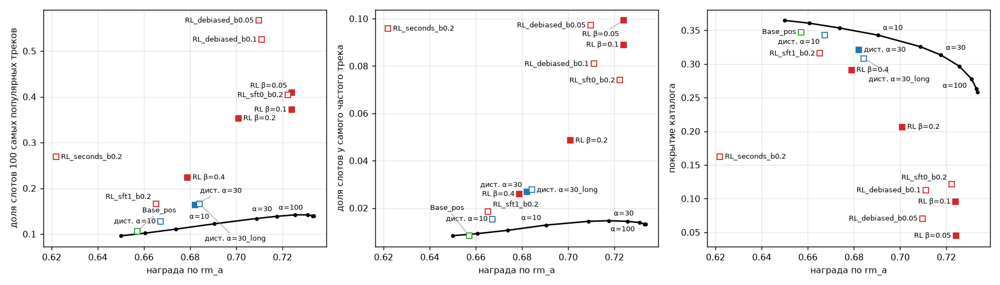

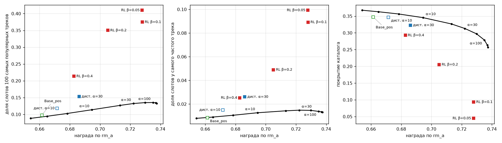

Покрытие считается на выборке из 20 000 контекстов и зависит от её размера (на 6 000 у базы 0,365), поэтому сравнивать его нужно внутри одной таблицы.

**Траектории обучения** (seed 42):

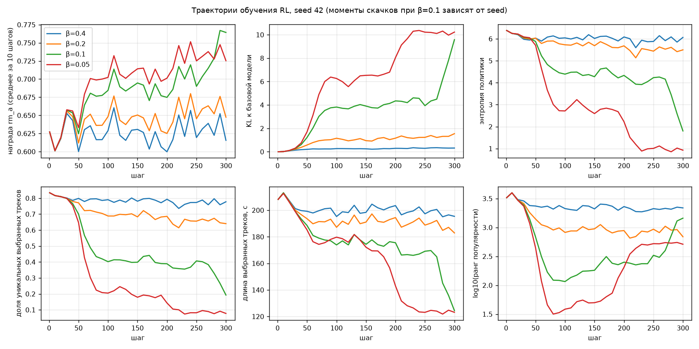

При β ≤ 0,1 политика сначала быстро схлопывается на популярные треки (энтропия 6,4 → 1–4, доля уникальных выборов 0,83 → 0,1–0,4, log10 ранга 3,5 → 1,5–2), затем у сильных настроек падает длина выбираемых треков (с 208 до 123–140 с). Моменты скачков при β=0,1 зависят от seed (на seed 43 и 44 второй скачок к 300-му шагу ещё не наступил), поэтому точки β ≤ 0,1 — срез движущейся динамики, а не равновесия.

**Объяснение изменений.** Награда `rm_a` определяется контекстом на 94% дисперсии, самим треком на 2,7% и их взаимодействием на 3,2% (разложение на 600 контекстов × 200 случайных треков из топ-10k). Запас на выбор трека мал, и политика с общими весами находит способ поднять награду через глобально «удобные» треки (популярные, подходящей длины). Это интерпретация, согласующаяся с наблюдениями, но не доказанная (см. раздел 8).

### 6.2. Сохраняется ли релевантность

Нет: чем сильнее оптимизация, тем ниже Recall@10 (0,345 → 0,316 / 0,258 / 0,159 / 0,109 при β = 0,4 / 0,2 / 0,1 / 0,05 на val; NDCG@10 0,204 → 0,186 / 0,148 / 0,082 / 0,047). На самом мягком режиме потеря Recall@10 около 8%. Проверка на «всем одно и то же»: при β=0,05 один трек получает 9,9% всех слотов, а при β=0,1 8,8% (у базы 0,8%), покрытие каталога падает с 0,581 до 0,09–0,18.

**Сверка с реальными исходами по логам.** В метрике «реальная доля прослушивания на попаданиях» берётся реальный `played_ratio` того следующего трека, который попал в топ-10:

| Метод | val R@10 | val реальная доля на попаданиях | test реальная доля на попаданиях |
|---|---|---|---|
| `base_all` (α=0) | 0,345 | 0,688 [0,675; 0,700] | 0,690 [0,676; 0,704] |
| переранжирование α=50 | 0,238 | 0,764 [0,751; 0,777] | 0,761 [0,745; 0,777] |
| переранжирование α=100 | 0,183 | 0,793 [0,778; 0,807] | 0,788 [0,771; 0,804] |
| RL β=0,4 | 0,316 | 0,696 | 0,698 |
| RL β=0,2 | 0,258 | 0,707 | 0,706 |
| RL β=0,1 | 0,159 | 0,729 [0,712; 0,745] | 0,711 [0,691; 0,730] |

Среди оставшихся попаданий реальная доля прослушивания растёт (RM действительно отличает более слушаемые треки), но число попаданий падает быстрее. Суммарная реальная метрика (R@10 × доля) у базы 0,237 (val) и 0,226 (test) и **ни у одного метода не выше**. При сильных настройках RL реальная доля на попаданиях ниже, чем у переранжирования при той же предсказанной награде (на тесте 0,711 против ≈0,755), хотя интервалы для сравнения нужно трактовать осторожно: это отбор по логам, а не причинный эффект.

### 6.3. Компромисс релевантность — награда

- Кривая переранжирования: до α = 5 награда растёт на 0,024 почти бесплатно (R@10 0,345 → 0,345), далее каждая единица награды стоит всё дороже; потолок награды 0,729–0,734 при потере 64% Recall@10.
- RL лежит ниже кривой: разрыв −0,025 при самой мягкой настройке и до −0,136 при самой сильной. Для дистилляции α=10 разрыв −0,006 (в пределах одного процентного пункта, но интервал не включает ноль).

### 6.4. Влияние функции награды и настроек RL

**Функция награды (переранжирование, val, 6 000 контекстов; рисунок):**

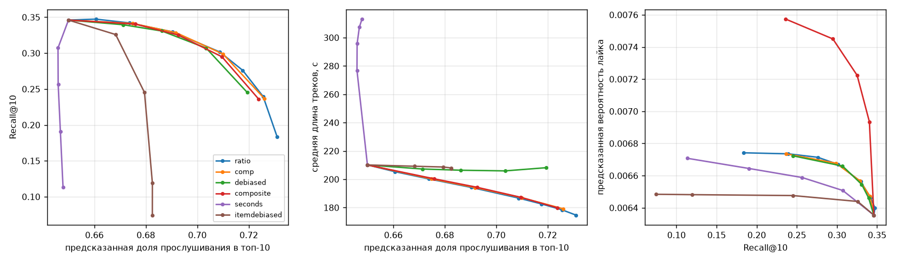

| Награда | вывод |
|---|---|
| `ratio` / `comp` / `composite` / `debiased` | практически одна кривая Парето по Recall@10 (различия в пределах шума) |
| `debiased` (вычитается средняя доля прослушивания для длины трека) | убирает сдвиг в короткие треки (длина 210 → 208 с вместо 210 → 178 с), цену релевантности не меняет |
| `composite` (доля дослушивания + лайки − дизлайки) | +19% к предсказанной вероятности лайка (0,0064 → 0,0076) при той же потере Recall@10 |
| `seconds` (награда в секундах прослушивания) | взлом самой формулировки: длина выбираемых треков растёт до 313 с, а предсказанная доля прослушивания не растёт (0,650 → 0,648) |
| `itemdebiased` (минус среднее по треку из train) | слишком дорого по релевантности (максимум подъёма +0,033) |

**Настройки RL (val, 20 000 контекстов, 1 seed, если не указано):**

| Конфигурация | R@10 | награда | разрыв | комментарий |
|---|---|---|---|---|
| β=0,2, λ=0,1 (3 seed) | 0,258 | 0,696 | −0,060 | базовая настройка |
| β=0,2, λ=0 (без SFT-якоря) | 0,165 | 0,718 | −0,090 | политика уходит гораздо дальше |
| β=0,2, λ=1,0 | 0,334 | 0,660 | −0,012 | якорь SFT работает как сильный регуляризатор |
| `debiased` β=0,1 / 0,05 | 0,176 / 0,137 | 0,707 / 0,706 | −0,123 / −0,166 | длина сохраняется (189 / 187 с), но выдача сильнее концентрируется на популярном (доля 0,52 / 0,56) |
| `seconds` β=0,2 | 0,235 | 0,617 | не определён | длина 298 с, награда по `ratio` ниже базы |
| 1024 последовательности на шаг (вдвое больше) | 0,245–0,246 | 0,699–0,702 | −0,065…−0,069 | разрыв не уменьшился |
| дистилляция α=30, 3000 шагов, lr 1·10⁻⁴ | 0,313 | 0,680 | −0,025 | выходит на плато около 40% целевого подъёма |

---

## 7. Дополнительные исследовательские вопросы

### 7.1. Генерация на несколько шагов вперёд

Пять треков генерируются подряд, каждый раз добавляясь в контекст (val, 4 000 контекстов, `base_all`):

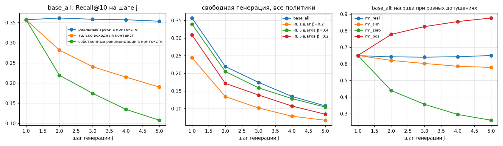

| Режим | Recall@10 на шаге 1 | на шаге 5 |
|---|---|---|
| реальные треки в контексте (teacher forcing) | 0,357 | 0,353 |
| только исходный контекст, без генерации | 0,357 | 0,190 |
| собственные рекомендации в контексте, без повторов | 0,357 | 0,108 |

- **Жадная генерация вырождается**: при добавлении собственного top-1 на шаге 2 модель повторяет его в 94% случаев, на шагах 3–5 в 97–99%. В реальных данных подряд идущие повторы встречаются в 4,4% прослушиваний, то есть это артефакт жадной генерации. В режиме без повторов вырождения нет.
- Падение Recall (0,357 → 0,190) частично неизбежно: мы не видим, что пользователь слушал между шагами. Подстановка собственных рекомендаций добавляет ещё около 45% потери от этого уровня (оговорка: контрольный режим не исключает ранее сгенерированные треки, поэтому величина примерная).
- **Оценка награды последовательности не определена данными**: одну и ту же цепочку (шаг 5) RM оценивает в 0,26 при допущении «пользователь всё пропустил», 0,58 при собственных предсказаниях RM и 0,88 при допущении «всё дослушал». Награда по сгенерированной цепочке в основном отражает выбранное допущение о реакции.
- RL, обученный на горизонте 5 с симулированным фидбэком (RM подставляет собственные вероятности), дрейф не уменьшил: Recall@10 на шаге 5 при свободной генерации 0,104 (β=0,4) и 0,084 (β=0,2) против 0,108 у базы.

Ограничения: оценка идёт при жадной генерации, а RL обучался на сэмплировании; симулятор фидбэка мягкий (вероятности вместо исходов 0/1).

### 7.2. Долгосрочные цели

**Постановка.** Модель `rm_long` предсказывает четыре исхода по истории и следующему треку: ещё минимум 1, 3 или 10 дослушанных треков в той же сессии (сессия — разрыв > 30 минут) и появление пользователя в сервисе на следующий календарный день. Используются все события (органические и рекомендованные) из `activity_daily`.

**Результаты (val, ROC-AUC):**

| Исход | доля | `rm_long` | простой baseline |
|---|---|---|---|
| ≥ 1 ещё в сессии | 0,771 | 0,630 | 0,630 (возраст сессии) |
| ≥ 3 | 0,548 | 0,642 | 0,608 |
| ≥ 10 | 0,225 | 0,682 | 0,626 |
| возврат на следующий день | 0,619 | 0,642 | **0,733** (личная частота возврата пользователя в train) |

Предсказание возврата на следующий день хуже простой привычки пользователя: окно в 128 событий не видит долгосрочной активности.

**Переранжирование по долгосрочной награде** (val, топ-100):

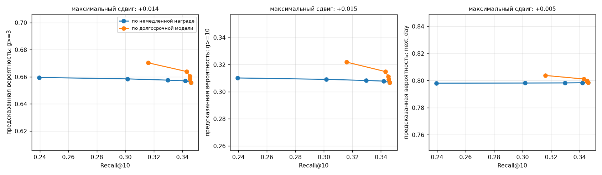

Максимальный сдвиг предсказанных исходов: +0,014 для ≥ 3, +0,015 для ≥ 10, +0,005 для возврата на следующий день ценой около 0,03 по Recall@10. Переранжирование по немедленной награде эти исходы почти не двигает (+0,002…+0,003): две цели почти ортогональны.

**Почему эффект мал.** Предсказания `rm_long` определяются контекстом (пользователем и состоянием сессии) на 97–99%, самим треком на 0,2–1,4% и взаимодействием на 0,5–1,5% (у возврата на следующий день трек объясняет 0,2%). Либо выбор трека действительно мало влияет на возврат, либо модель, обученная на наблюдательных данных, не различает этот эффект.

**Что можно и что нельзя проверить офлайн.**

| Можно офлайн | Нельзя офлайн |
|---|---|
| предсказуемость исходов на отложенной неделе, сравнение с простыми baseline | причинный эффект рекомендаций на удержание: логи записаны под прежней системой, возвраты определяются в основном привычками |
| сколько дисперсии определяется выбором трека | эффект политик с трековым покрытием, отсутствующим в логах |
| поведение выдачи и модельные оценки исходов при переранжировании | горизонты 7/30 дней, отток, подписка: метки в конце периода цензурированы |

Для проверки необходим онлайн A/B-тест с метриками удержания D1/D7, временем в сервисе и контрольными метриками (дизлайки, разнообразие потребления).

---

## 8. Почему RL проигрывает переранжированию: диагностические эксперименты

Все диагностики на val (10 000–20 000 контекстов), 1 seed; переранжирование для наград без модели — по K=1000 кандидатов.

| Награда | Результат |
|---|---|
| `log10` ранга популярности (без модели) | **RL не хуже переранжирования**: разрыв −0,001 (β=4), +0,001 (β=2), −0,001 (β=1), +0,011 (β=0,4), +0,024 (β=0,2) |
| средняя доля прослушивания трека в train, `itemmean` (без модели, не совпадает с популярностью) | **разрыв такой же, как для `rm_a`**: −0,001 (β=2), −0,010 (β=1), −0,026 (β=0,4), −0,050 (β=0,2) |
| `itemdebiased` | при β=0,2: награда не растёт, R@10 падает до 0,287; при β=0,05 коллапс на длинные треки (231 с, доля уникальных выборов 3%) |
| вдвое больше последовательностей на шаг | разрыв не уменьшился |
| дистилляция замкнутого оптимума | −0,006 (α=10), −0,018…−0,021 (α=30) |

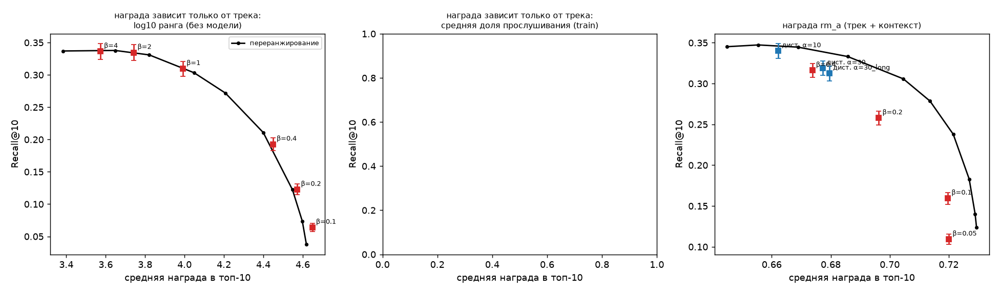

**Что подтверждено:**

- разрыв не связан с реализацией RL: для награды, согласованной с направлением, которое политика уже кодирует (ранг популярности), он не возникает;
- разрыв для наград, являющихся произвольной функцией трека или контекста, воспроизводится на 3 seed и на тесте;
- простая фильтрация позитивов и увеличение числа сэмплов не устраняют проблему.

**Что опровергнуто.** До эксперимента `itemmean` я зафиксировала предсказание: «разрыв RL с переранжированием не меньше −0,01 при всех β, если награда зависит только от трека». Оно не подтвердилось (−0,026 и −0,050 при β = 0,4 и 0,2). Поэтому моё предыдущее объяснение («RL плохо усваивает контекстную часть награды, а трековую хорошо») отвергнуто, и в отчёт оно включено только как опровергнутая гипотеза.

**Что остаётся гипотезой.** Награды, гладко связанные с признаками, которые политика уже кодирует, оптимизируются без потерь, а произвольные функции от идентификатора трека требуют перестройки логитов отдельных треков через общие эмбеддинги и обходятся дороже, чем независимый пересчёт кандидатов в каждом контексте. Не исключены недообученность (300 шагов, один lr), ограничение ёмкости политики и особенности реализации.

---

## 9. Неудачи и ограничения

**Неудачи:**

1. RL не превзошёл переранжирование ни при одной настройке, оптимизируя награду по обученной RM.
2. Все RL-политики показали нежелательное поведение (концентрация на популярном, падение покрытия, сокращение длины треков) на сильных настройках.
3. Многошаговое RL (горизонт 5) не уменьшило дрейф.
4. Долгосрочную награду не удалось приблизить: `rm_long` предсказывает возврат хуже личной привычки пользователя.
5. Две начальные гипотезы были опровергнуты своими же экспериментами: (а) «длина треков причина потери релевантности» (вариант `debiased` убрал сдвиг длины, потеря релевантности осталась); (б) «разрыв определяется контекстной частью награды» (эксперимент `itemmean`).
6. Первый запуск дистилляции содержал ошибку лосса (кросс-энтропия по полному словарю при цели, заданной только на кандидатах): она искусственно стягивала массу в топ-100; исправлена, приведены результаты исправленной версии.

**Ограничения:**

- Одна архитектура (GPT-2, 16 млн параметров), один датасет, одна версия RL (on-policy REINFORCE), 300 шагов, один lr (гиперпараметры RL широко не перебирались).
- Базовая модель обучалась 4 эпохи, метрики росли до последней эпохи.
- Награда оценивается моделью, обученной на наблюдательных (organic) данных; на рекомендуемые треки, которых пользователь не слушал, она экстраполирует. `rm_b` почти копия `rm_a`, поэтому проверка взлома награды слабая.
- Потолок релевантности: в тесте 71–74% целей попадают в словарь; метрики считаются только по ним; «новый» трек означает «не слышал среди organic-прослушиваний» (мог слышать в рекомендациях).
- Сверка с реальными исходами консервативна: она видит только то, что пользователи реально слушали в логах.
- Часть конфигураций (`debiased`, `seconds`, варианты λ, дистилляция α=10, диагностики) прогнана в одном seed.
- Тест прогнан два раза (6 000 и 20 000 контекстов) на одном и том же замороженном списке конфигураций; подбор гиперпараметров по тесту не проводился. Диагностические эксперименты (наши `novelty`, `itemmean`, `itemdebiased` и т. п.) исследовались только на val и в тест не выносились.
- Многошаговая оценка — жадная, симулятор фидбэка мягкий.
- Временной сдвиг: между val и test растут доля позитивных прослушиваний и средняя длина треков, абсолютные метрики на тесте ниже на 0,01–0,02.

---

## 10. Дальнейшие шаги

1. **Off-policy обучение на реальных исходах** с поправкой весов важности (идея статьи 2), чтобы не зависеть от RM.
2. **Пессимистичная награда** по ансамблю RM (штраф за расхождение) и действительно независимый судья `rm_c` (без канала фидбэка, другие данные).
3. Более длинное и тонко настроенное RL (lr, число шагов, G), RL над кандидатами, архитектуры политики с явным использованием оценок кандидатов.
4. RL с долгосрочной наградой (`rm_long`); предсказание офлайн «эффекта не будет» (из разложения дисперсии) не проверялось.
5. Симулятор фидбэка с бинарными исходами для многошаговой оценки.
6. **Онлайн A/B-тест** с метриками удержания D1/D7, временем в сервисе и контрольными метриками.

---

## 11. Воспроизведение

### 11.1. Окружение

Windows 10/11, Python 3.12, PyTorch 2.6.0+cu124 (RTX 3050 Ti, 4,3 ГБ), остальные зависимости в `requirements.txt` и `requirements.lock.txt` (точные версии).

```powershell
git clone <https://github.com/AlexDm207/yambda.git>
cd yambda-rl
python -m venv .venv
.\.venv\Scripts\Activate.ps1
pip install torch --index-url https://download.pytorch.org/whl/cu124
pip install -r requirements.txt
python scripts/check_env.py
```

### 11.2. Данные и сплит

```powershell
python data/download.py          # Yambda-50M, multi_event.parquet (≈385 МБ)
python data/prepare.py           # временной сплит, словарь по train, проверки утечек (≈ несколько минут)
python scripts/evaluate.py --split val   # простые baseline
```

### 11.3. Модели (полный прогон ≈ 8–10 часов на RTX 3050 Ti)

```powershell
python train/sft.py --mode all --name base_all --epochs 4
python train/sft.py --mode pos --name base_pos --epochs 4
python train/train_rm.py --name rm_a --epochs 3
python train/train_rm.py --name rm_b --seed 7 --n_layer 3 --n_embd 192 --epochs 3
python train/train_long.py --name rm_long --epochs 3

foreach ($s in 42,43,44) { foreach ($b in 0.4,0.2,0.1,0.05) {
  python train/rl.py --name "rlstd_beta${b}_s$s" --reward ratio --adv_norm std --beta $b --steps 300 --seed $s } }
foreach ($s in 42,43,44) {
  python train/distill.py --name "distillfull_a30_s$s" --reward ratio --alpha 30 --target full --steps 1500 --seed $s }
python train/distill.py --name distillfull_a10 --reward ratio --alpha 10 --target full --steps 1500
```

В исходных экспериментах seed 42 для β = 0,4 / 0,2 / 0,1 сохранён под именами `rlstd_beta{β}`, а для β = 0,05 под `rl_ratio_b05` (первый запуск), `scripts/run_final.ps1` ссылается именно на эти имена. При запуске с нуля либо переименуйте чекпоинты, либо замените пути seed 42 в `run_final.ps1` на `..._s42`.

### 11.4. Итоговая оценка и отчётные артефакты

```powershell
.\scripts\run_final.ps1 -split val -tag big -n_eval 20000   # основные таблицы val
.\scripts\run_final.ps1 -split test -tag big -n_eval 20000  # единственный открытый тестовый прогон
python scripts/eval_rm.py --split test --ckpt checkpoints/rm_a/best.pt
python scripts/eval_multistep.py --ckpt checkpoints/base_all/best.pt --no_repeat
python scripts/eval_long.py --alphas 0 5 10 20 50 --anova
python scripts/make_tables.py ; python scripts/make_figures.py ; python scripts/make_figures2.py
```

Диагностики из раздела 8: `scripts/run_exp3.ps1`, `scripts/run_exp4.ps1` (после `scripts/patch_final_eval.py`, `scripts/patch_final_eval2.py`, `scripts/patch_itemmean.py`).

Все числа отчёта и 95% интервалы собраны в `reports/tables.md`, сырые результаты в `reports/results/*.json`, логи обучения в `reports/logs/`. Веса в репозиторий не входят (`.gitignore`).

### 11.5. Структура репозитория

```
configs/base.yaml        конфигурация (словарь, контекст, сплит, модель)
data/                    download.py, prepare.py, loader.py, inspect_data.py, eda_extra.py
models/                  gpt_rec.py (политика), reward_model.py
train/                   sft.py, train_rm.py, train_long.py, rl.py, distill.py
eval/                    metrics.py, evaluate.py, rm_eval.py
src/                     utils.py, rl_lib.py (награды, генерация, оценка кандидатов)
scripts/                 evaluate.py, eval_rm.py, eval_reward.py, eval_multistep.py, eval_long.py,
                         final_eval.py, rm_anova.py, make_figures*.py, make_tables.py, run_*.ps1
reports/                 tables.md, figures/, results/, logs/
```

---

*Все выводы относятся к описанной постановке (on-policy REINFORCE с KL-штрафом и якорем SFT, GPT-2 на 16 млн параметров, Yambda-50M, награда по обученной модели) и не утверждают, что RL для рекомендаций «не работает» в общем случае.*
